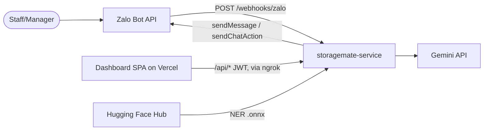
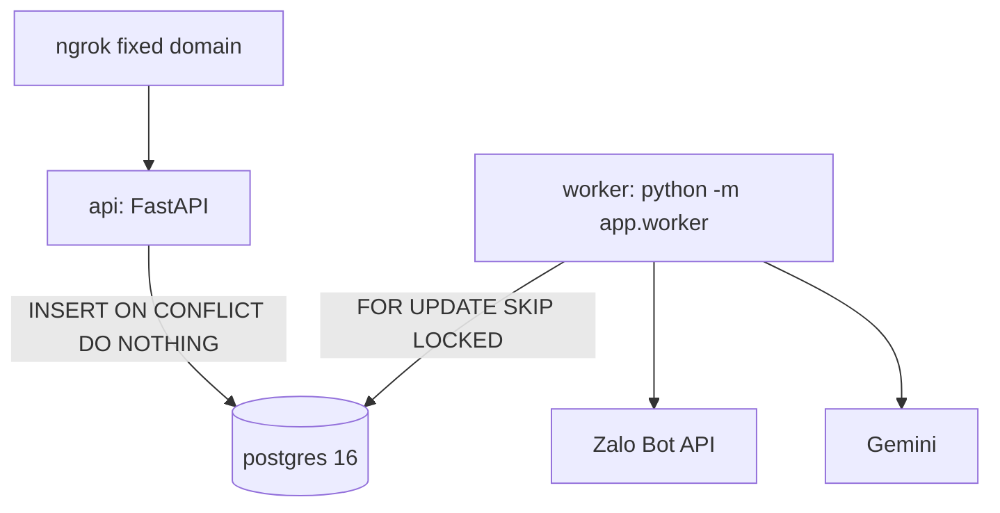
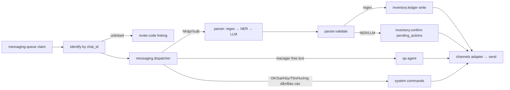

# Architecture
> last-updated: 2026-11-01

## L1 — Context

## L2 — Containers (docker-compose)

| Container | Responsibility | Tech | Talks to |
|-----------|----------------|------|----------|
| api | Webhook (verify secret, normalize, enqueue, 200 fast), REST for dashboard, web chat in | FastAPI, Uvicorn | postgres |
| worker | Claim queue, identify sender, route, parse cascade, validate, ledger write / pending confirm, reply, APScheduler reports, Q&A | same image; ONNX Runtime, LangChain, httpx | postgres, Zalo, Gemini |
| postgres | Ledger (source of truth), queue, catalog, training samples | PostgreSQL 16 | — |

**Exactly one worker instance** (APScheduler jobs must not double-fire).

## L3 — Components (worker message path)

## Communication patterns
- Webhook → queue is async via Postgres table (`inbound_messages`), dedup on `(channel, message_id)`.
- Channel adapter abstraction (`app/channels/base.py`): Zalo and web chat share the pipeline; Zalo OA = new adapter only.
- Zalo API retries: 408/429/403 backoff+jitter max 3; 400/401/404 no retry.
- Pending confirmations expire after 10 min; `Hủy` allowed within 30 min.

## Cross-cutting concerns
- Auth: webhook secret header (`hmac.compare_digest`); admin JWT (PyJWT + pwdlib argon2) on `/api/*`.
- Config: `app/config.py` pydantic-settings from `.env`.
- Errors: `AppError` → JSON handler (`app/exceptions.py`).
- Timezone: `Asia/Ho_Chi_Minh`; store `timestamptz`.
- Proposal shows a monorepo (`apps/api`, `apps/web`); **actual layout is a standalone service repo with domain folders** — see directory-map.md. <!-- unknown: confirm whether monorepo merge is still planned -->
