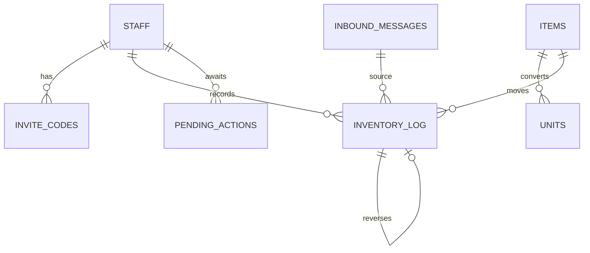

# Database Design
> last-updated: 2026-11-01 · status: **designed, not yet migrated** (`app/*/models.py` are stubs, `alembic/versions/` empty)

If this doc and the Alembic migrations diverge, the migration wins — fix this doc.

## Engine & access
PostgreSQL 16 via SQLAlchemy 2.0 sync + psycopg 3 (`app/database.py`, `pool_pre_ping`). Alembic migrations.
Two roles: app (`DATABASE_URL`) and `qa_reader` (`DATABASE_URL_READONLY`, SELECT on business views only,
`statement_timeout` 5 s, max 200 rows). Constraint names from `NAMING_CONVENTION` in `app/models.py`.

## ERD

## Tables
| Table | Key columns | Purpose | Domain |
|-------|-------------|---------|--------|
| admins | id, email, password_hash, created_at | Dashboard login (1 admin via script) | auth |
| staff | id, name, role(staff/manager), zalo_user_id UNIQUE, zalo_chat_id, active, linked_at | Identity | staff |
| invite_codes | id, staff_id, code, expires_at, used_at, failed_attempts | One-time Zalo linking | staff |
| items | id, name, base_unit, aliases, min_stock | Catalog | items |
| units | id, item_id, unit_name, factor | Unit conversion (1 thùng = 24 hộp) | items |
| inbound_messages | id, channel, message_id, chat_id, sender_id, event_name, text, payload jsonb, received_at, status, attempts, error | Queue + dedup | messaging |
| outbound_messages | id, chat_id, text, sent_at, zalo_message_id, status, error | Bot send log | messaging |
| pending_actions | id, staff_id, chat_id, parsed jsonb, parser_source, confidence, expires_at, status | Await OK/Sai | inventory |
| inventory_log | id, item_id, action IN/OUT, qty, unit, qty_base, event_time, received_at, staff_id, inbound_id, raw_message, parser_source, confidence, reverses_id | **Ledger, source of truth** | inventory |
| training_samples | id, raw_message, labels, parser_source, verified, corrected_by, created_at | NER flywheel | labels |

View `current_stock`: `items LEFT JOIN inventory_log`, `SUM(IN qty_base) − SUM(OUT qty_base)` (plain view, not materialized).

## Invariants & constraints
- `inventory_log` is **append-only** — no UPDATE/DELETE. Cancel/fix = new row with `reverses_id` and flipped action.
- `UNIQUE(channel, message_id)` on `inbound_messages`.
- `qty > 0`; OUT must not make stock negative (checked in validate before insert).
- `event_time` ≤ now and ≥ now − 7 days; `event_time` (from text) separate from `received_at` (webhook).
- Quantities `NUMERIC`, times `timestamptz`. `qty_base` stored in the item's base unit.
- Invite codes: 6 chars, single use, 24 h TTL; >5 failures in 15 min → lock chat_id.

## Indexing & performance notes
1 shop, low volume. Expected hot paths: queue claim (`status`, `received_at`), ledger by `item_id`/`event_time`,
staff by `zalo_chat_id`. <!-- unknown: finalize indexes when writing the first migration -->

## Migrations
`alembic revision --autogenerate -m "..."` → review → `alembic upgrade head`. Never edit an applied migration.
Multi-tenant later = `stores` table + `store_id` columns.
