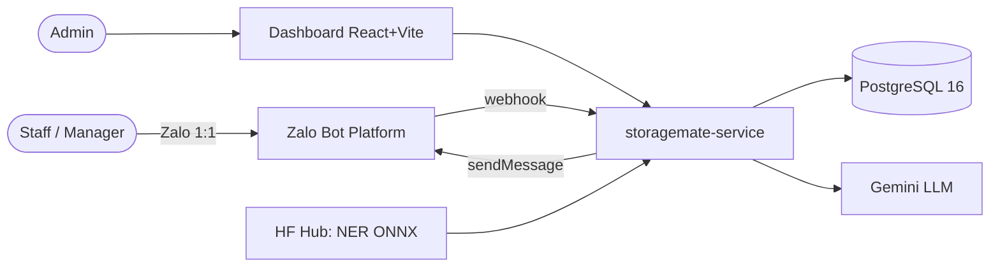

# Overview
> last-updated: 2026-11-01 · source: `docs/storagemate-proposal-plan-v2.md` (*Storagemate-Proposal-Plan v2*, 2026-11-01)

## What it is
storagemate-service is the backend of **Storagemate**: an AI agent on **Zalo Bot** (1:1 chat) that reads F&B staff
messages like `Nhập 50 kg bột mì 14h 28/10`, writes them to an append-only inventory ledger, keeps stock real-time,
confirms back to the staff member, answers manager questions, and sends daily/monthly reports.

## Who it's for
| Persona | Channel | Does |
|---------|---------|------|
| Staff (nhân viên) | Zalo Bot | Nhập/Xuất, `Tồn …`, `Hủy`, `OK`/`Sai` |
| Manager | Zalo Bot | All of the above + free-form Q&A + `Báo cáo` |
| Admin (shop owner) | Dashboard (React, separate repo) | Staff + invite codes, items/units, stock, transactions, label review |
| Judge / demo user | Web chat on dashboard | Same pipeline as Zalo |

## The problem & the north star
Today a manager re-reads the group chat at month end and types totals into a sheet: hours of work, errors,
no real-time stock. North star: every stock movement is captured at the moment it is messaged, correct, and
queryable — month-end stocktake becomes a report, not a chore. Also a learning goal: full loop
ingestion → parser (regex + self-trained NER) → DB → Q&A → dashboard → retrain flywheel.

## Scope / non-goals
- In scope: 1 shop; Zalo Bot 1:1 + web chat via channel adapters; regex → NER (ONNX) → LLM parser cascade with
  human OK/Sai for NER/LLM reads; append-only ledger with reversals; unit conversion; reports via APScheduler;
  admin JWT dashboard API; training_samples for the flywheel.
- Explicitly NOT doing (phase 1): Zalo group chats, Zalo OA, image/receipt OCR, multi-tenant (`store_id` later),
  realtime model updates, public signup.

## Roadmap (phases)
0 Zalo bot setup · 1 non-AI ingestion (adapters, queue, invite codes, regex, ledger, reports) · 2 NER + LLM fallback ·
3 Q&A + dashboard · gate: local E2E on Compose + golden set · 4 auth · 5 deploy · 6 flywheel.

## Open decisions
- LLM: Gemini free tier vs self-host — decide in Phase 2 (code currently assumes Gemini via `GEMINI_API_KEY`).
- Can the bot message users proactively after silence? Does Zalo retry webhooks? — Phase 0 tests.
- Split NER into its own service? — when worker memory/latency is measured.

## System context (one glance)

